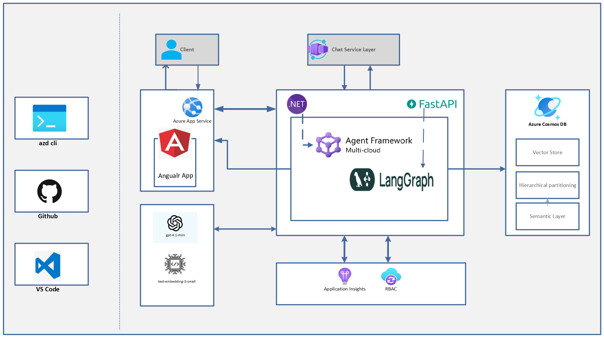
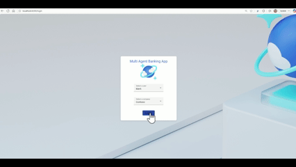

# Multi Agent Workshop

Welcome to our multi-agent samples repository showcasing a retail banking scenario. This repository demonstrates several approaches to building multi-agent applications using Azure Cosmos DB.

## Build a Multi-Agent AI application using Agent Framework Agents or LangGraph

This branch of the repo shows how to build a multi-tenant, multi-agent, banking application with containerized applications built using 

- Agent Framework Agents in C#
- LangGraph in Python

To explore the other scenarios showcased in this repository. [Go to main branch](https://github.com/AzureCosmosDB/banking-multi-agent-workshop/tree/main)

## Local runtimes

Use the .NET 10 SDK (including for the data loader), Node.js 24 LTS for the Angular 21 frontend, and Python 3.12 for the LangGraph and MCP services. In either frontend directory, run `npm ci` to install the checked-in lockfile.

Each Python service installs from its own `requirements.txt`. To refresh its lock, edit the adjacent `requirements.in` and run `uv pip compile requirements.in --upgrade --python-version 3.12 --universal --no-header --no-annotate -o requirements.txt` in that directory. Keep the corresponding exercise and completed copies in sync.

## Architecture Diagram

Here’s the deployment architecture and components of the workshop!

## User Experience

# Branch Overview

This branch contains both exercise starter files and completed solutions for the sample multi-agent application in a retail banking scenario. You can either work through the exercises step by step or use the completed files to run the demo directly.

## 1. Exercises

Work through the exercises to build the application step by step:

- [LangGraph (Python)](01_exercises/python/langgraph/workshop/Module-0.md)  
- [Agent Framework (C#)](01_exercises/csharp/workshop/Module-0.md)  

## 2. Completed Files

If you prefer to skip the exercises and run as demo directly, use the final code and artifacts:

- [LangGraph (Python)](02_completed/python/langgraph/README.md)  
- [Agent Framework (C#)](02_completed/csharp/README.md)
